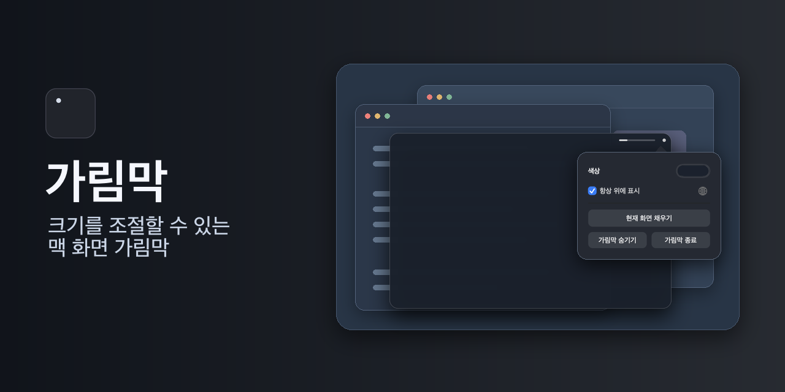

# 가림막

맥 화면 일부를 단색으로 가리는 앱입니다. 가림막을 옮겨 놓고, 필요할 때 뒤쪽 창만 앞으로 가져올 수 있습니다.

**macOS 13 이상** · **Swift와 AppKit**

**[macOS용 다운로드](https://github.com/HanbeenMoon/focus-shade/releases/latest/download/FocusShade-macOS.zip)** · [빌드 방법](#빌드) · [English](README.md)



## 설치

macOS 13 이상을 쓰는 Apple Silicon 맥과 Intel 맥에서 사용할 수 있습니다.

1. ZIP을 내려받아 압축을 풉니다.
2. **가림막.app**을 **응용 프로그램**으로 옮겨 실행합니다.
3. 처음 뜨는 안내에서 **시작하기**를 누릅니다. 나중에는 메뉴 막대의 **가림막 → 빠른 사용 안내**에서 다시 볼 수 있습니다.

다운로드 파일은 로컬 서명됐으며 Apple 공증을 받지 않았습니다. macOS가 첫 실행을 막으면 이 저장소에서 내려받은 파일인지 먼저 확인하세요. Apple은 **시스템 설정 → 개인정보 보호 및 보안**의 **그래도 열기**를 안내합니다. [직접 빌드](#빌드)할 수도 있습니다. [Apple 앱 열기 안내](https://support.apple.com/ko-kr/102445)

## 왜 만들었나요

여러 화면을 보며 작업하면 당장 필요 없는 창에 자꾸 눈이 갔습니다. 그렇다고 닫아두면 잠시 뒤 참고할 때 다시 찾아 열어야 했습니다.

그래서 “눈앞에서 치워두고, 필요할 때 한 동작으로 볼 수 있을까?”에서 시작했습니다. 크기와 위치를 조절할 수 있는 단색 창으로 시선이 가는 부분을 가리고, 더블클릭하면 바로 아래 창을 볼 수 있게 했습니다. 평소에 손이 가는 조작은 작은 점과 투명도 막대에 모았습니다.

## 사용법

| 동작 | 조작법 |
| --- | --- |
| 이동과 크기 조절 | 단색 면을 끌어 옮기고, 가장자리나 모서리에서 크기를 바꿉니다. 여러 디스플레이에 걸쳐 놓을 수 있습니다. |
| 화면 채우기와 복원 | 채울 디스플레이에서 상단 테두리를 더블클릭합니다. 한 번 더 더블클릭하면 이전 크기와 위치로 돌아옵니다. |
| 뒤쪽 창 가져오기 | 가림막의 단색 면을 더블클릭합니다. 가림막을 한 번 누르거나 Dock에서 다시 열면 다시 앞에 옵니다. |
| 투명도와 색상 설정 | 오른쪽 위의 가로 막대로 투명도를 조절합니다. 옆의 점을 눌러 색상과 항상 위에 표시를 설정합니다. |

점 메뉴에서 숨기거나 종료할 수 있습니다. 지구본 아이콘으로 한국어와 영어를 바꿀 수 있습니다. 창 위치와 크기, 색상, 투명도는 맥에 저장됩니다.

## 빌드

Xcode Command Line Tools 또는 Xcode를 설치한 뒤, 내려받은 소스 폴더에서 아래 명령을 실행합니다.

```sh
mkdir -p dist
build_dir=$(mktemp -d "$PWD/dist/build.XXXXXXXX")
./build.sh "$build_dir/가림막.app"
open "$build_dir/가림막.app"
```

빌드 스크립트는 앱을 로컬에서 서명합니다. Dock에 고정하려면 완성된 앱을 응용 프로그램 폴더로 옮긴 뒤 아이콘 메뉴에서 **옵션 → Dock에 유지**를 선택합니다.

## 문제 신고

[GitHub 이슈](../../issues/new/choose)에 macOS 버전과 재현 순서를 적어 주세요. 검사 방법은 [기여 안내](CONTRIBUTING.md)에 있습니다.
