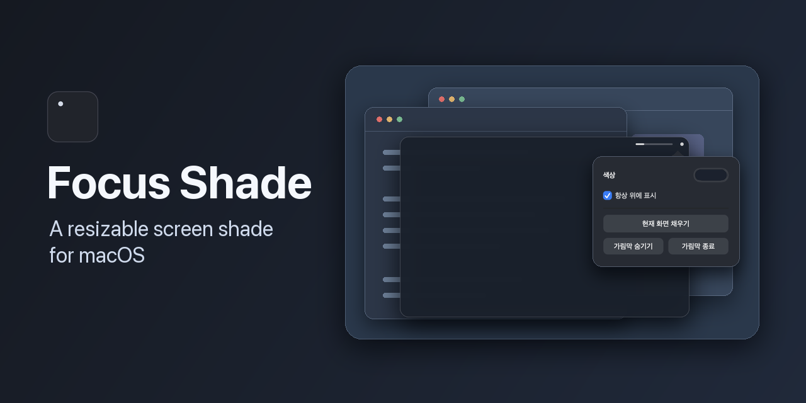

# Focus Shade

Focus Shade is a resizable overlay for macOS. Use it to cover part of a display and reveal a window underneath when you need it.

**macOS 13 or later** · **Swift and AppKit**

[Build from source](#build) · [Releases](../../releases) · [한국어](README.ko.md)



## Use it

| To | Do this |
| --- | --- |
| Cover part of the screen | Drag the solid area to move the shade. Drag an edge or corner to resize it. The shade can span displays. |
| Fill a display | Double-click the top edge on that display. Double-click the top edge again to restore the previous size and position. |
| Reveal a covered window | Double-click the solid area over the window. Click the shade once or reopen it from the Dock to cover it again. |
| Adjust the look | Drag the thin bar at the top right. Open the small dot menu to change the color or toggle always-on-top. |

The dot menu also lets you hide or quit the overlay. The app remembers its position, size, color, and transparency in local macOS preferences. Its controls currently use Korean labels.

## Build

Install Xcode Command Line Tools or Xcode, then open the downloaded source directory in Terminal.

```sh
mkdir -p dist
./build.sh "$PWD/dist/가림막.app"
open "$PWD/dist/가림막.app"
```

The script builds and signs the bundle locally. To keep it in the Dock, use the app icon’s **Options → Keep in Dock** menu.

## Report a problem

Open a [GitHub issue](../../issues/new/choose) with your macOS version and steps to reproduce. For build and test commands, see [Contributing](CONTRIBUTING.md).
